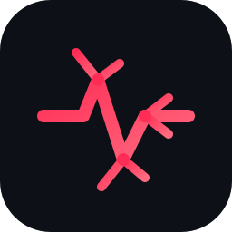

<div align="center">



# Vein

### The data engine that runs your whole stack from a single query.

**One engine for batch, streaming, ETL/ELT, business logic, and query-as-a-service.**

Write a query once. Run it as batch or streaming. Serve it as an API. Extend it with Wasm. All in one language, one root, one engine — built in Rust for efficiency and cost control.

</div>

<p align="center">
  
  
  
  
</p>

---

**Vein** is a complete, distributed **data engine** written in Rust. It unifies **batch and streaming**, lets you **build ETL/ELT and business logic in a single root**, **serve any query as a REST/gRPC API via `WRITE`**, and extend it with **Wasm/eBPF UDFs** — engineered to be highly efficient and to dramatically lower the cost and complexity of a modern data stack.

```sql
-- One pipeline: read → transform → aggregate → publish
FROM 's3://orders/2026/orders.parquet' WITH (format = 'parquet')
|> WHERE amount > 100
|> EXTEND amount * 1.08 AS amount_with_tax
|> AGGREGATE SUM(amount_with_tax) AS total, COUNT(*) AS n
   GROUP BY user_id
|> WRITE 's3://analytics/totals' (mode = 'append', format = 'parquet')
```

```sql
-- Read from a stream or an API endpoint
FROM kafka://orders/topic                 -- stream
FROM api://orders                         -- API endpoint
```

```sql
-- Use case: a live revenue dashboard for the finance team.
-- Each new order flows through kafka, joins the customer master, and the
-- endpoint's response updates in real time — no separate streaming engine,
-- no hand-written API layer. It's one query and one WRITE.
FROM kafka://orders/topic
|> JOIN customers ON orders.customer_id = customers.id
|> EXTEND orders.amount * (1 - customers.discount_rate) AS net
|> AGGREGATE SUM(net) AS revenue, COUNT(*) AS orders, AVG(net) AS aov
   GROUP BY customers.region, TUMBLE(time, '1h')
|> WRITE api::rest://insights/revenue   -- GET /insights/revenue?region=APAC → JSON
-- |> WRITE api::grpc://insights/revenue -- gRPC endpoint (protobuf)
```

```sql
-- Vector: embed, rank, and serve semantic search — first-class VECTOR type
FROM products
|> EXTEND EMBED(name || ' ' || description) AS embedding   -- Vector(1536)
|> ORDER BY VECTOR_DISTANCE(embedding, :query_embedding, 'cosine') ASC
|> LIMIT 10
|> WRITE api::rest://search/products     -- → nearest-match JSON results
```

---

## Table of Contents

- [Why Vein](#why-vein)
- [Features](#features)
- [Quick Start](#quick-start)
- [Architecture](#architecture)
- [Workspace](#workspace)
- [Status](#status)
- [Roadmap](#roadmap)
- [Contributing](#contributing)
- [License](#license)

---

## Why Vein

The modern data stack is a pile of disconnected tools: a warehouse, a streaming system, an ETL orchestrator, and a separate backend just to serve APIs. Each one has its own language, its own ops burden, and its own license bill.

**Vein collapses all of that into one query language and one engine.** You write the logic once, run it as batch *or* streaming, and serve it as an API — without stitching together half a dozen systems.

- **One root.** ETL, ELT, and business logic live together in a single, testable pipeline.
- **Batch and streaming, unified.** A batch query is a single-epoch streaming query — no separate engines to learn or operate.
- **Query as a service.** `WRITE api::rest://…` / `api::grpc://…` turns any query into a live REST or gRPC endpoint, Spring-Boot style — no hand-written API layer.
- **Built for cost.** Morsel-driven, vectorized execution over Arrow, a zero-copy `rkyv` wire protocol and `SelectionVector` filtering, and first-class budget guards for AI operators.

---

## Features

- **Pipe-syntax SQL.** A flat, composable pipeline language: `SELECT`, `WHERE`, `QUALIFY`, `AGGREGATE`, `ORDER BY`, `LIMIT`, `EXTEND`, `SET`, `DROP`, `RENAME`, `AS`, `DISTINCT`, `JOIN`, `CALL`, `TABLESAMPLE`, `ASSERT`, `SETOP`, `PIVOT`, `UNPIVOT`, `WITH`, `WRITE`, `FORK`, `TEE`.
- **Unified batch + streaming.** An incremental (DBSP) execution model where any batch query is mechanically convertible to a streaming query.
- **Vector embeddings, first-class.** A native `VECTOR` type with `EMBED` and `VECTOR_DISTANCE` for AI / similarity workloads.
- **Query as a service.** `WRITE api::rest://…` / `api::grpc://…` publishes any query as a live REST or gRPC endpoint.
- **Advanced UDFs.** A multi-runtime function model — **Wasm** for the bulk of business logic (safe, sandboxed, near-native), **eBPF** for kernel-level speed, **Python** for data-science.
- **Zero-copy, end to end.** A `rkyv` wire protocol for copy-free serialization over QUIC, `SelectionVector`-based filtering that never copies rows, and mmap-backed storage — data moves between nodes and operators without unnecessary deserialization or copying.
- **Efficient & cost-aware by design.** Morsel-driven vectorized execution, an Iceberg versioned catalog with scan-plan caching, and FinOps guards that cap AI-operator spend.

---

## Quick Start

Vein is a Rust workspace. Build, test, and run it locally.

```bash
# Build the entire workspace
cargo build --workspace

# Run the full test suite (parser, binder, plan, optimizer, executor)
cargo test --workspace
```

### Run a node

```bash
# A full Master + Executor cluster in a single process
cargo run -p cli -- local

# Standalone nodes
cargo run -p cli -- master --bind 0.0.0.0:8080
cargo run -p cli -- executor --bind 0.0.0.0:8081 --master 127.0.0.1:8080
```

### Inspect a plan

```bash
# EXPLAIN renders the optimized logical plan without executing
EXPLAIN FROM users |> SELECT id, name
```

### A complete pipe-syntax query

```sql
FROM users
|> WHERE age > 18
|> EXTEND age * 2 AS double_age
|> AGGREGATE SUM(age) AS total_age, COUNT(*) AS n GROUP BY name
```

Read from object storage and write back:

```sql
FROM 's3://bucket/data.parquet' WITH (format = 'parquet')
|> SELECT id, amount
|> WRITE 's3://bucket/out' (mode = 'append', format = 'parquet')
```

---

## Architecture

```text
SQL ─▶ parser ─▶ AST ─▶ binder ─▶ LogicalPlan ─▶ optimizer ─▶ [optimized]
                                                                      │
    client ◀─ Arrow IPC ◀─ sink ◀─ operators ◀─ executor ◀─ QUIC dispatch ◀─ scheduler ─▶ StageDag
                                (VFS shuffle / hash-join spill)
```

1. **Parser** — pipe-syntax SQL to an AST.
2. **Binder** — the semantic frontend: resolves columns, scopes, types, and functions into a validated, type-coerced `LogicalPlan`.
3. **Optimizer** — rule-based rewrites over the logical plan.
4. **Physical planner** — lowers the optimized plan into a `StageDag` of executable stages.
5. **Scheduler** — dispatches stages across the cluster (batch waves + streaming topologies) over QUIC.
6. **Executor** — stateless, morsel-driven nodes that read sources, apply operators, and push results through sinks, shuffling through VFS.

---

## Workspace

Vein is organized as a Cargo workspace of focused crates:

| Crate | Responsibility |
|---|---|
| `parser` | Pipe-syntax SQL → AST |
| `binder` | AST → typed, coerced `LogicalPlan` (semantic frontend) |
| `plan` | Shared logical IR: `LogicalPlan`, `LogicalExpr`, `VeinSchema`/`VeinDataType` |
| `optimizer` | Rule-based logical-plan optimization |
| `orchestrator` | Physical planning (`StageDag`), scheduling, executor registry, task dispatch |
| `exec` | Stateless executor: pipeline traits, operators, expression evaluator, QUIC daemon |
| `common` | rkyv wire protocol, identifiers, cancellation, `SelectionVector`, transport |
| `vcs` | Versioned catalog service (Iceberg), scan planning, plan cache |
| `vfs` | VeinFS — the unified data plane (mmap blocks, CRUSH topology, redb metadata) |
| `ebpf` | eBPF compiler |
| `error` | Unified `VeinError` |
| `cli` | `vein-server` binary + the `DistributedCoordinator` engine wiring |

---

## Status

Honest state of the project:

- ✅ **Implemented & tested.** The complete semantic frontend — parser, binder, plan IR, optimizer — plus the rkyv wire protocol, scheduler orchestration, the executor operator/expression library, the VCS catalog seam, and VeinFS scaffolding.
- 🚧 **In progress.** Physical execution: `StageDag` lowering, executor operator wiring, the QUIC dispatcher, and the Arrow IPC data plane.
- 🧭 **Roadmap.** Streaming runtime, Wasm/eBPF UDF execution, query-as-a-service (`WRITE api::…`), ETL framework, vector ANN, and distributed elasticity.

### Pipeline status

Every stage of the query pipeline below is tracked; the green stages are implemented and covered by tests, the amber stage is under active construction.

| Stage | Component | Status |
|---|---|---|
| 1. Parse | Pipe-syntax SQL → AST (`parser`) | ✅ Implemented & tested |
| 2. Bind | AST → typed, coerced `LogicalPlan` (`binder`) | ✅ Implemented & tested |
| 3. Optimize | Rule-based rewrites (`optimizer`) | ✅ Implemented & tested |
| 4. Plan physically | Lower to `StageDag` (`orchestrator`) | 🚧 In progress |
| 5. Schedule | Stage dispatch over QUIC (`orchestrator`) | 🚧 In progress |
| 6. Execute | Operators + expression eval (`exec`) | 🚧 In progress |
| 7. Serve | Arrow IPC data plane & `WRITE` sinks (`exec` / `common`) | 🧭 Roadmap |

The engine is under active development — the frontend is real and tested; execution, streaming, and the service layer are being built out toward the roadmap below.

---

## Roadmap

- **Physical execution** — complete `StageDag` lowering, executor wiring, real QUIC dispatch, and the Arrow IPC data plane.
- **Unified streaming** — the DBSP incremental runtime so any batch query runs continuously.
- **Query as a service** — `WRITE api::rest://…` and `WRITE api::grpc://…` publish any query as a live REST or gRPC endpoint.
- **Advanced UDF runtime** — execute Wasm / eBPF / Python functions end-to-end.
- **Connectivity** — a single URI model across reads and writes:

  | Direction | Form |
  |---|---|
  | Read object store | `READ s3://bucket` · `FROM 's3://bucket/data.parquet' WITH (format='parquet')` |
  | Read stream | `READ kafka://topic` |
  | Read API | `READ api://endpoint` |
  | Write object store | `WRITE s3://bucket` · `WRITE 's3://bucket' (mode='append')` |
  | Write REST | `WRITE api::rest://customer/v2` |
  | Write gRPC | `WRITE api::grpc://customer/v1` |

- **Vector ANN** — approximate-nearest-neighbor indexes for `VECTOR_DISTANCE`.
- **Agents & AI integration** — an agent/query-memory (MCP) layer on top of the engine.
- **Factorized & WCOJ execution** — Kuzu-style factorized chunks and worst-case-optimal joins.
- **Elasticity & eBPF** — Type-5 elastic morsel scheduling and eBPF kernel pushdown.

---

## Contributing

Contributions are welcome. This is an early-stage engine, so the highest-impact work is:

1. Fork the repo and create a branch from `main`.
2. `cargo build --workspace` and `cargo test --workspace` to verify the baseline.
3. Pick an item from the [Roadmap](#roadmap) or an open issue.
4. Open a pull request — tests must pass and `cargo clippy --workspace` must be clean.

---

## License

This project is licensed under the [Apache License 2.0](LICENSE).